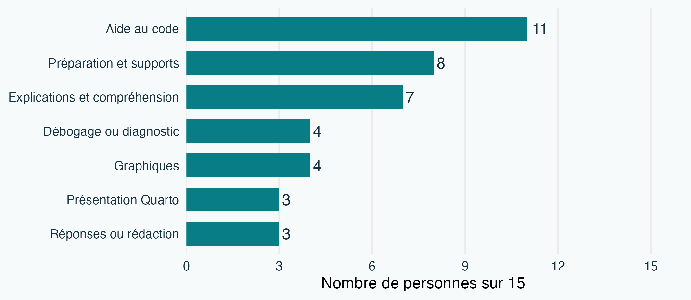

##  {#ouverture .dark background-color="#083d53"}

<h1 class="hero-title">Du code répété<br>aux fonctions</h1>
<p class="hero-subtitle">Fonctions en R et retour sur le défi 2</p>
<p class="hero-meta">Aurélien Nicosia · 4 novembre 2026<br>STT-4230 / STT-6230</p>

## Aujourd'hui

- Revenir sur le défi 2 et discuter des usages déclarés de l'IA.
- Lire et écrire des fonctions en R.
- Distinguer `if` et `ifelse()` dans une fonction.
- Revoir brièvement les boucles.

## Défi 2 : usages déclarés de l'IA

::: lead
12 personnes sur 15 ont déclaré une aide de l'IA pour la préparation ou le défi.
:::

Ces usages comprennent la préparation; ils ne correspondent pas tous à un recours pendant la séance.

## Pour quelles tâches ?

{fig-alt="Aide au code : 11 personnes; préparation : 8; explications : 7; débogage : 4; graphiques : 4; présentation Quarto : 3; rédaction : 3, sur 15 personnes." height="560"}

Une personne peut avoir mentionné plusieurs usages.

## Avant ou pendant le défi

- Préparer : demander des explications sur les données et les jointures ou générer un exercice de pratique.
- Pendant le défi : chercher de l’aide pour une erreur, une jointure ou le rapport.
- Une aide reçue en préparation peut être déclarée même sans nouvel appel pendant la séance.

## Que vérifie-t-on ?

- Essayer une proposition et examiner le résultat.
- Contrôler un invariant, comme le nombre de lignes attendues.
- Refaire un calcul simple par une autre méthode.

Qu’est-ce que chaque vérification permet de détecter ?

## Ce que les déclarations permettent de dire

- Les usages rapportés prennent plusieurs formes.
- La précision des descriptions et des vérifications varie.
- Les déclarations ne mesurent pas l’effet de l’IA sur la note ou l’apprentissage.

## Discutons des pratiques

- Comment demander une explication qui aide à comprendre une fonction ?
- Comment vérifier une proposition avant de l'utiliser ?
- Que faut-il documenter pour expliquer ce qu'on a retenu ?

## Ce que vous souhaitez reprendre

- `if` et `ifelse()` pour classer des valeurs.
- Les fonctions, leurs arguments et leurs environnements.
- Un bref retour sur les boucles; `switch()` en complément.

## Une question pour commencer

On dispose des mesures suivantes :

```r
mesures <- c(12, 8, NA, 15, 10)
```

Comment calculer la proportion de valeurs observées qui atteignent 10 ?

Que devrait-on retourner si toutes les valeurs sont manquantes ?

## Comparer des valeurs

```r
mesures <- c(12, 8, NA, 15, 10)
mesures >= 10
# TRUE FALSE NA TRUE TRUE
```

- La comparaison est appliquée à chaque élément.
- Une comparaison avec `NA` produit `NA`.
- Une valeur exactement égale à 10 satisfait `>= 10`.

## Une condition pour choisir

```r
n_observe <- sum(!is.na(mesures))

if (n_observe > 0) {
  message("Au moins une mesure observée")
} else {
  message("Aucune mesure observée")
}
```

La condition de `if` doit être une seule valeur logique non manquante.

## Un choix global ou un choix par élément ?

```r
x <- c(8, NA, 12)
if (length(x) > 0) "non vide" else "vide"
# "non vide"

ifelse(x >= 10, "atteint", "sous le seuil")
# "sous le seuil" NA "atteint"
```

`if` prend une condition de longueur 1; `ifelse()` traite ici chaque élément.

## Une catégorie par valeur

```r
x <- c(8, NA, 12)
ifelse(x >= 10, "atteint", "sous le seuil")
# "sous le seuil" NA "atteint"
```

`ifelse()` renvoie ici un résultat par élément. La valeur manquante reste manquante.

## Les boucles : un rappel rapide

```r
x <- c(4, 7, 2)
resultat <- numeric(length(x))
for (i in seq_along(x)) {
  resultat[i] <- x[i]^2
}
resultat
# 16 49 4
```

Pour ce calcul, `x^2` produit directement le même résultat.

## Une fonction : entrées, calcul, sortie

```r
carre <- function(x) {
  x^2
}

carre(c(3, 6, 9, 12))
# 9 36 81 144
```

`x` est un argument. La dernière expression évaluée est retournée.

## Lire une fonction

```r
classer_mesures <- function(x, seuil = 10) {
  ifelse(x >= seuil, "atteint", "sous le seuil")
}
```

- Entrées : `x` et `seuil`, dont la valeur par défaut est 10.
- Sortie : une catégorie par valeur de `x`.
- Une valeur manquante dans `x` demeure manquante.

## Appeler et vérifier

```r
classer_mesures(c(8, 10, NA, 12))
# "sous le seuil" "atteint" NA "atteint"

classer_mesures(c(8, 10, NA, 12), seuil = 12)
# "sous le seuil" "sous le seuil" NA "atteint"
```

Quel est l'effet du seuil ? Qu'arrive-t-il à la valeur manquante ?

## Construire une fonction utile

```r
proportion_seuil <- function(x, seuil = 10) {
  observes <- x[!is.na(x)]
  if (length(observes) == 0) {
    return(NA_real_)
  }
  mean(observes >= seuil)
}
```

La proportion porte sur les valeurs observées. Si aucune n'est disponible, le résultat est manquant.

## Retourner une valeur ou signaler une erreur

```r
calculer_moyenne <- function(x) {
  if (!is.numeric(x)) stop("x doit être numérique")
  if (length(x) == 0) return(NA_real_)
  mean(x)
}
```

- `return()` termine la fonction et renvoie une valeur.
- `stop()` interrompt le calcul en signalant une erreur.

```r
calculer_moyenne(numeric(0))  # NA
calculer_moyenne("abc")       # erreur : x doit être numérique
```

## Essayer plusieurs entrées

```r
proportion_seuil(c(12, 8, NA, 15, 10))
# 0.75
proportion_seuil(c(12, 8, NA, 15, 10), seuil = 12)
# 0.5
proportion_seuil(c(NA, NA))
# NA
```

Que représente le dénominateur dans chaque cas ?

## Arguments et valeur par défaut

```r
proportion_seuil(c(12, 8, 15), seuil = 10)
proportion_seuil(c(12, 8, 15))
```

Les deux appels utilisent le même seuil. Nommer un argument peut rendre l'intention plus claire.

## Où R trouve-t-il les objets ?

```r
facteur <- 2
multiplier <- function(x) {
  x * facteur
}
multiplier(3)
```

La fonction trouve `facteur` à l'extérieur de son appel. Comment rendre cette dépendance explicite ?

## Rendre la dépendance explicite

```r
multiplier <- function(x, facteur) {
  x * facteur
}
multiplier(3, facteur = 2)
# 6
```

Les arguments décrivent ce dont la fonction a besoin pour calculer son résultat.

## Une fonction et son environnement

```r
creer_multiplicateur <- function(facteur) {
  function(x) x * facteur
}
doubler <- creer_multiplicateur(2)
doubler(3)
# 6
```

La fonction retournée conserve l'accès à `facteur` dans son environnement de création.

## Complément : choisir avec `switch()`

```r
resume_simple <- function(x, mesure = "moyenne") {
  switch(mesure,
    moyenne = mean(x),
    somme = sum(x),
    stop("Mesure inconnue")
  )
}
resume_simple(c(2, 4, 6), "somme")
# 12
```

Ici, `mesure` choisit un calcul pour l'ensemble du vecteur.

## À vous : faire évoluer la fonction

À partir de `proportion_seuil()` :

1. Décrivez les entrées et la sortie.
2. Essayez un vecteur sans valeur manquante, puis un vecteur vide.
3. Modifiez le seuil et vérifiez le résultat à la main.
4. Discutez du comportement souhaité si le seuil est manquant.

## Appliquer la même fonction à plusieurs groupes

```r
groupes <- list(A = c(12, 8, NA), B = c(15, 10))

vapply(groupes, proportion_seuil, numeric(1), seuil = 10)
#   A   B
# 0.5 1.0
```

La fonction est appliquée à chaque élément de la liste. `numeric(1)` décrit la forme attendue de chaque résultat.

## En laboratoire

- Faire les exercices sur les structures de contrôle et les fonctions.
- Pour chaque fonction, essayer un cas simple et un cas limite.
- Consigner une difficulté, sa correction et une vérification dans le portfolio.
- Faire le point sur le projet et les prochaines étapes de l'équipe.

## Portfolio : jalon 2

- Progression et traces variées depuis le premier jalon.
- Une amélioration à la suite d'une difficulté ou d'une rétroaction.
- Organisation, chemins relatifs et indications de relance.
- Déclaration lorsque l'usage de l'IA a été significatif.

Pousser les changements sur GitHub avant l'échéance indiquée dans Brio.

## Pour la suite

- Une condition choisit entre des actions.
- Une fonction nomme un calcul et rend ses entrées explicites.
- Une boucle répète un traitement lorsque nécessaire.
- La semaine prochaine : tests, exceptions et débogage.

## Références {#references .refs}

- Notes du cours : [structures de contrôle](https://stt4230.rbind.io/programmation/struct_controle_r/), [fonctions](https://stt4230.rbind.io/programmation/fonctions_r/) et [informations techniques sur R](https://stt4230.rbind.io/programmation/infos_techniques_r/).
- Wickham, H. (2019). *Advanced R*, 2e éd. [Control flow](https://adv-r.hadley.nz/control-flow.html) et [Functions](https://adv-r.hadley.nz/functions.html).
- R Core Team. [Documentation R](https://stat.ethz.ch/R-manual/R-devel/library/base/html/Control.html), structures de contrôle.
